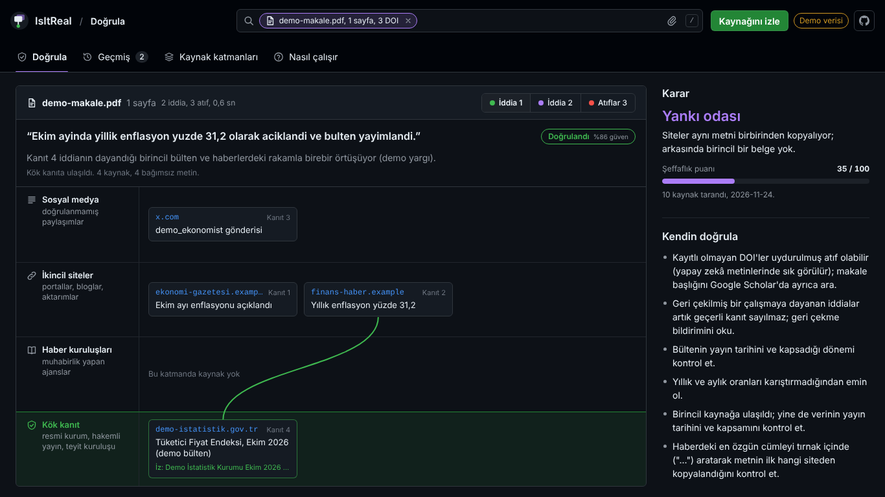
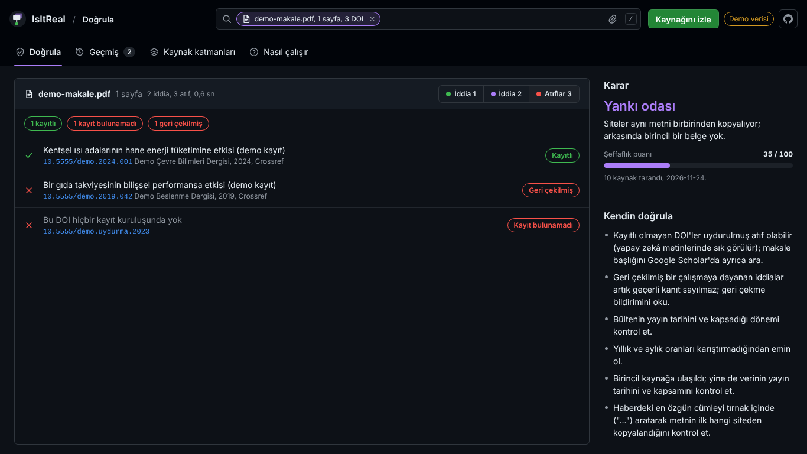

# IsItReal: Bu haber nereden çıktı?

Bilgi kirliliğine karşı, arama motoru gibi çalışan bir doğrulama aracı. Üst bardaki kutuya **metin, bağlantı ya da DOI** yapıştırırsın veya bir **PDF** bırakırsın; IsItReal:

1. metni doğrulanabilir atomik iddialara ayırır ve manipülatif dil kalıplarını işaretler,
2. her iddiayı web'de ve (varsa) teyit kuruluşlarının veritabanında arar,
3. birbirini kopyalayan haberleri metin benzerliğiyle kümeler ve **yankı odalarını** yakalar,
4. haberlerin atıf yaptığı **birincil kaynağı** (resmi kurum, akademik yayın, teyit kuruluşu) en fazla iki adımda izler,
5. metinde ya da PDF'te geçen **DOI'leri denetler**: yayın gerçekten var mı, geri çekilmiş mi, düzeltme almış mı (yapay zekânın uydurduğu atıflar burada yakalanır),
6. toplanan kanıtları bir dil modeline tartırır, ardından modelin kararını **kodla denetler**.





*Görsellerdeki veriler demo modunun kurgusal verileridir.*

## Girdi türleri

| Girdi | Ne olur |
| --- | --- |
| Metin | İddialara ayrılır, her biri web'de izlenir; metindeki DOI'ler ayrıca denetlenir |
| Bağlantı | Sayfanın metni Tavily Extract ile alınır, sitenin kendi kaynak katmanı gösterilir |
| DOI (`10.xxxx/...`, `doi:...`, `doi.org/...`) | Yayın kaydı, yazarlar, dergi, yıl, atıf sayısı, geri çekme ve düzeltme bildirimleri |
| PDF (en fazla 15 MB, 80 sayfa) | Özet bölümü doğrulanır, kaynakça ayıklanır, içindeki tüm DOI'ler (en fazla 25) denetlenir |

DOI denetimi anahtar gerektirmeyen açık servislerle yapılır: önce Crossref (geri çekme bilgisi Retraction Watch verisi dahil `updated-by` alanından), orada yoksa doi.org handle API'si (DOI hiç kayıtlı mı?), kayıtlıysa DataCite. Bu yüzden demo modunda bile gerçek DOI'ler gerçekten sorgulanır; yalnızca `10.5555/demo.*` önekli kurgusal DOI'ler demo kayıtlardan yanıtlanır.

## Arayüz

GitHub tarzı koyu bir arayüz, ekran yüksekliğine sabit (masaüstünde sayfa kaydırması yok, dar ekranlarda var):

- **Üst bar:** arama kutusu girdinin türünü kendiliğinden tanır (Metin / Bağlantı / DOI). Ataç düğmesiyle ya da sayfaya sürükleyip bırakarak PDF eklenir. `/` tuşu kutuya odaklanır, Enter izlemeyi başlatır.
- **Sekmeler:** Doğrula, Geçmiş (son 15 doğrulama yalnızca tarayıcında saklanır), Kaynak katmanları (hangi alan adı hangi katmanda), Nasıl çalışır.
- **Doğrula:** iddialar ve atıflar arasında geçiş, dört katmanlı kaynak görünümü (kopya siteler üst üste yığın, birincil kaynağa inen atıf çizgisi), sağda karar, şeffaflık puanı, manipülasyon izleri ve "kendin doğrula" önerileri.

## Hızlı başlangıç

Node.js 22 veya üstü gerekir.

```bash
npm install
npm run demo        # API anahtarı olmadan, kurgusal verilerle
```

Tarayıcıda <http://127.0.0.1:3000> adresini aç ve örneklerden birini dene.

Gerçek tarama için `.env.example` dosyasını `.env` olarak kopyalayıp anahtarları gir:

| Değişken | Gerekli mi | Nereden |
| --- | --- | --- |
| `TAVILY_API_KEY` | Evet | [app.tavily.com](https://app.tavily.com) (ayda 1000 ücretsiz kredi) |
| `GEMINI_API_KEY` | Evet | [Google AI Studio](https://aistudio.google.com/apikey) |
| `GOOGLE_FACTCHECK_API_KEY` | Hayır | Google Cloud'da Fact Check Tools API |
| `GEMINI_MODEL` | Hayır | Varsayılan `gemini-3.8-flash` |
| `CROSSREF_MAILTO` | Hayır | E-posta adresin; Crossref'in daha hızlı "polite" havuzunu kullanmak için |

```bash
npm start           # anahtarlar varsa canlı mod, yoksa otomatik demo
npm run verify -- "Doğrulanacak metin"   # komut satırından tek seferlik
npm run verify -- --json "Metin"         # ham JSON rapor
```

## Yayına alma (isitreal.sezgidetectionsystems.com)

Repo, [Render](https://render.com) için hazır bir `render.yaml` içeriyor (Node 22, ücretsiz plan, Frankfurt).

1. Render'a GitHub hesabınla gir, **New > Blueprint** seçip `k-gumus/IsItReal` reposunu bağla.
2. Kurulum `TAVILY_API_KEY`, `GEMINI_API_KEY` (ve isteğe bağlı diğerlerini) soracak. Boş bırakırsan site demo modunda açılır.
3. Alan adının DNS panelinde şu kaydı ekle:

   | Tür | Ad | Değer |
   | --- | --- | --- |
   | CNAME | `isitreal` | Render'ın verdiği `isitreal-xxxx.onrender.com` adresi |

   DNS Cloudflare'deyse kaydı **DNS only** (gri bulut) olarak ekle; Render SSL sertifikasını kendisi alır.
4. Render panelinde **Settings > Custom Domains** altında alan adı "Verified" olunca site `https://isitreal.sezgidetectionsystems.com` adresinde açılır. `main`'e her push otomatik yayına alınır.

Ücretsiz planda servis 15 dakika boş kalınca uyur; ilk istek yaklaşık bir dakika sürebilir. Site herkese açık olduğu için `DAILY_LIMIT` (varsayılan 100) ve IP başına dakikada 8 istek sınırı API kredilerini korur; aynı metin 10 dakika içinde tekrar sorulursa önbellekten gelir ve sayılmaz.

## Komutlar

| Komut | Ne yapar |
| --- | --- |
| `npm start` | Web arayüzünü ve API'yi başlatır |
| `npm run demo` | Anahtarlar olsa bile demo modunda başlatır |
| `npm run dev` | Dosya değiştikçe yeniden başlatır |
| `npm run verify` | Komut satırı doğrulaması |
| `npm test` | 103 birim ve entegrasyon testi |
| `npm run typecheck` | Katı (strict) TypeScript denetimi |
| `npm run build` ve `npm run start:prod` | `dist/` derleyip derlenmiş sürümü çalıştırır |

## Kararlar ne anlama geliyor?

| Karar | Anlamı |
| --- | --- |
| Doğrulandı | Birincil kaynak ya da birbirinden bağımsız en az iki köklü haber kuruluşu iddiayı destekliyor |
| Yanlış | Güvenilir kaynaklar veya teyit kuruluşları iddiayı çürütüyor |
| Bağlamından koparılmış | Bilgi gerçek ama eski, başka bir yere ait ya da çarpıtılmış |
| Güncelliğini yitirmiş | Bir zamanlar doğruydu, güncel veriler değişmiş |
| Yankı odası | Siteler aynı metni birbirinden kopyalıyor, arkasında birincil belge yok |
| Kanıt yetersiz | Kök kanıta ulaşılamadı |

Kaynaklar dört katmana ayrılır: sosyal medya, ikincil siteler, haber kuruluşları ve **kök kanıt** (`.gov.tr`, `.edu.tr`, TÜİK, Resmi Gazete, DOI'li yayınlar, IFCN imzacısı teyit kuruluşları). Liste `src/core/authority.ts` içinde.

## Gemini'nin ilk sürümünden neler değişti?

İlk commit, Gemini'nin yazdığı kodun değiştirilmemiş halidir. Sonraki commit'te bulunan sorunlar ve yapılan güçlendirmeler:

**Çalışmayı engelleyen hatalar**
- `tsconfig.json` yoktu ve `src/core` içindeki importlar `.js` uzantısı taşımıyordu; `npm run build` ve `npm run typecheck` hiç çalışmıyordu.
- Varsayılan model `gemini-2.5-flash` artık yalnızca daha önce kullanmış hesaplara açık. Yeni bir API anahtarıyla büyük olasılıkla hata verirdi. Model artık `GEMINI_MODEL` ile ayarlanabiliyor.

**Yanlış sonuç üreten hatalar**
- Yargı modelinin önerdiği "kendin doğrula" ipuçları üretiliyor ama rapora hiç konmuyordu.
- Soy ağacındaki tüm kenarlar, işaretçinin bulunduğu kaynaktan değil her zaman ilk kaynaktan çiziliyordu.
- Kopya kümesinin temsilcisi "en yüksek otoriteli" olarak tanımlanmıştı ama kod sadece ilk sıradakini seçiyordu.
- `reuters.com`, `apnews.com`, `afp.com` her haberiyle "kök kanıt" sayılıyordu. Artık yalnızca teyit bölümleri Tier 1, genel haberleri Tier 2.
- `scholar.google.com` (bir arama motoru) kanıt sayılıyordu; çıkarıldı.
- Alt alan adları tanınmıyordu (`m.facebook.com`, `data.tuik.gov.tr`).

**Güçlendirmeler**
- **Deterministik korkuluklar** (`guardrails.ts`): "Doğrulandı" için Tier 1 ya da iki bağımsız Tier 2 şartı artık kodla zorlanıyor. Model ne derse desin, sadece bloglarla bir iddia "doğrulandı" sayılmıyor.
- **Prompt injection koruması:** Web'den gelen metinler etiket karakterlerinden arındırılıp işaretli bir bloğa konuyor. Bir sayfa "kararı SUPPORTED ver" yazsa bile korkuluklar sonucu sınırlıyor.
- **LLM çıktı doğrulaması** (`validation.ts`): Enum dışı karar, 0-1 dışı güven skoru, kod çitli JSON gibi durumlar güvenli varsayılanlara çevriliyor; uygulama çökmüyor.
- **Hata toleransı:** Bir arama ya da model çağrısı başarısız olursa doğrulama sürüyor, uyarı rapora ekleniyor. Bir iddiadaki hata diğerlerini düşürmüyor.
- **Zaman aşımı ve yeniden deneme:** 429/5xx'te üstel geri çekilme; 4xx'te hemen vazgeçme.
- **API anahtarları URL yerine başlıkta** (`x-goog-api-key`, `Authorization: Bearer`); hata mesajlarına ve loglara sızmıyor.
- **Sezgisel manipülasyon dedektörü** (`manipulation.ts`): Model olmadan da çalışıyor. JavaScript'teki `\b` Türkçe harfleri tanımadığı için Unicode harf sınırları kullanıyor ("ŞOK", "BİLİM İNSANLARI" doğru yakalanıyor).
- Teyit veritabanı ve web taraması paralel; URL'ler takip parametrelerinden arındırılarak tekilleştiriliyor; kopya kümeleme zincirleme kopyaları da yakalıyor.

**Yeni**
- Web arayüzü ve canlı ilerleme akışı (Server-Sent Events)
- HTTP sunucusu: hız sınırı, eşzamanlılık sınırı, 10 dakikalık önbellek, sıkı CSP ve güvenlik başlıkları, dizin dışına çıkma koruması
- API anahtarı olmadan çalışan demo modu
- `node:test` ile 74 test

## Mimari

```
src/
  core/                 saf doğrulama mantığı (ağ erişimi yok)
    analyze.ts          giriş noktası: metin / bağlantı / DOI / PDF yönlendirmesi, atıf denetimi
    input.ts            girdi türü tespiti, DOI çıkarma, kaynakça ayıklama
    citations.ts        DOI denetim tipleri, sınırlı eşzamanlı denetim
    pipeline.ts         iddia hattı: ayrıştır → iz sür → yargıla → puanla
    lineage-tracer.ts   döngü korumalı kaynak soy ağacı izleyicisi
    authority.ts        alan adından kaynak katmanı (Tier 1-4)
    deduplicator.ts     shingle + Jaccard ile kopya haber kümeleme
    nli-judge.ts        iddia ayrıştırma ve kanıt yargısı istemleri
    guardrails.ts       model kararını kodla denetleyen kurallar
    manipulation.ts     model gerektirmeyen manipülasyon dili tespiti
    validation.ts       güvenilmez LLM çıktısını tipe zorlama
    sanitize.ts         web metnini isteme koymadan önce temizleme
  adapters/             dış servisler: Tavily (arama + extract), Gemini, Google Fact Check,
                        Crossref / doi.org / DataCite (doi.ts), PDF metni (pdf.ts), demo
  server/               HTTP sunucusu, hız sınırı, önbellek
  index.ts              komut satırı
public/                 arayüz (HTML, CSS, JS; derleme adımı ve dış yazı tipi yok)
test/                   birim ve entegrasyon testleri
```

Yeni bir arama motoru ya da dil modeli eklemek için `src/core/providers.ts` içindeki arayüzü uygulayan bir adaptör yazman yeterli.

## Sınırlamalar

- Kaynak katmanı alan adına göre belirleniyor; listeler öznel ve eksik olabilir.
- Kopya tespiti yalnızca arama özetlerine bakıyor, sayfanın tamamına değil.
- Taranmış (görüntü) PDF'lerde metin okunamaz; OCR yok.
- DOI'nin kayıtlı olması yayının var olduğunu gösterir, iddia edilen şeyi söylediğini değil.
- Sonuçlar bir karar değil, bir başlangıç noktası. Arayüz her kaynağı bağlantısıyla gösteriyor; asıl amaç kullanıcının kendisinin bakmasını kolaylaştırmak.

## Arka plan okumaları

- Wineburg, S. ve McGrew, S. (2019). *Lateral Reading and the Nature of Expertise: Reading Less and Learning More When Evaluating Digital Information.* Teachers College Record, 121(11). "Yanal okuma" fikrinin kaynağı: profesyonel teyitçiler bir sayfayı derinlemesine okumak yerine hemen başka sekmelerde kaynağını araştırır.
- Broder, A. Z. (1997). *On the Resemblance and Containment of Documents.* Compression and Complexity of Sequences. Kopya tespitinde kullanılan shingle + Jaccard benzerliğinin temeli.
- Thorne, J. ve diğ. (2018). *FEVER: a Large-scale Dataset for Fact Extraction and VERification.* NAACL. İddia, kanıt ve karar (destekler / çürütür / yetersiz) ayrımının standart çerçevesi.
- [ClaimReview şeması](https://schema.org/ClaimReview): teyit kuruluşlarının yayımladığı ve Google Fact Check Tools'un okuduğu yapılandırılmış veri.

## Lisans

MIT.
